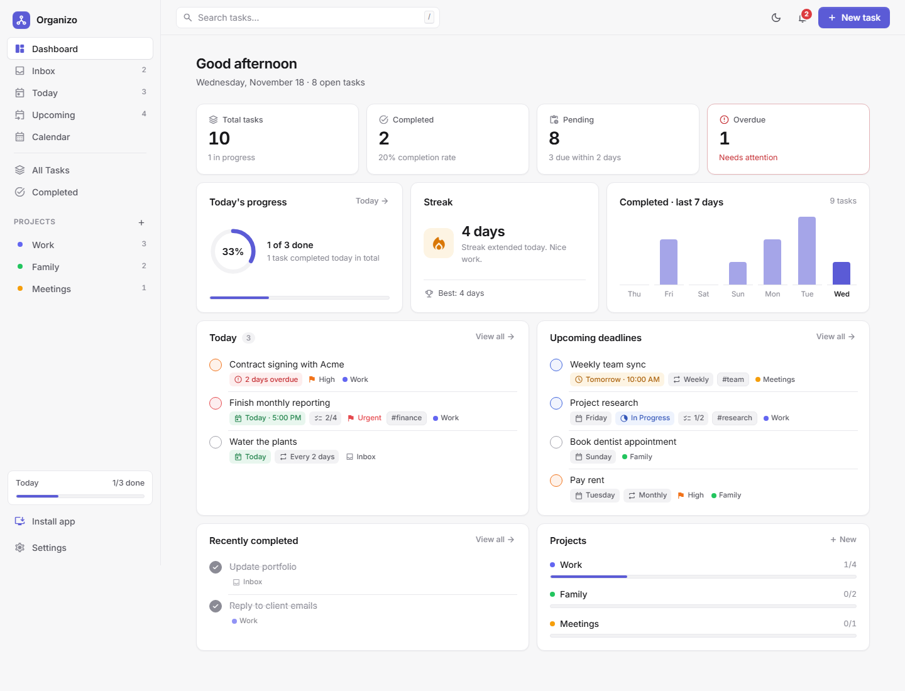
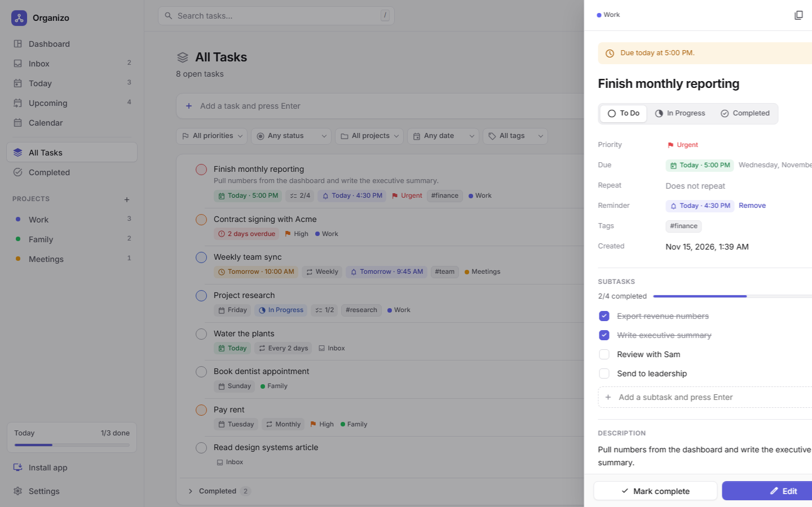
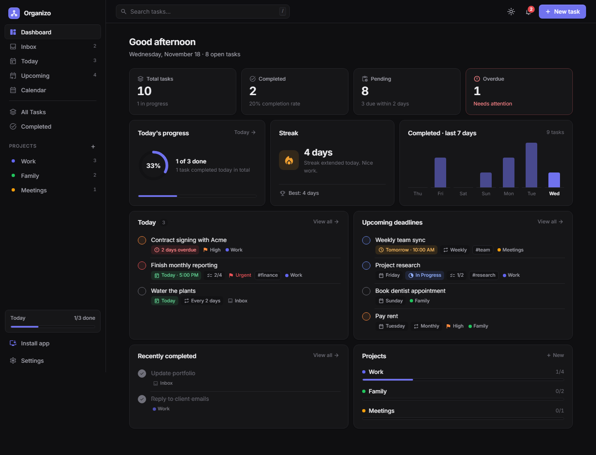
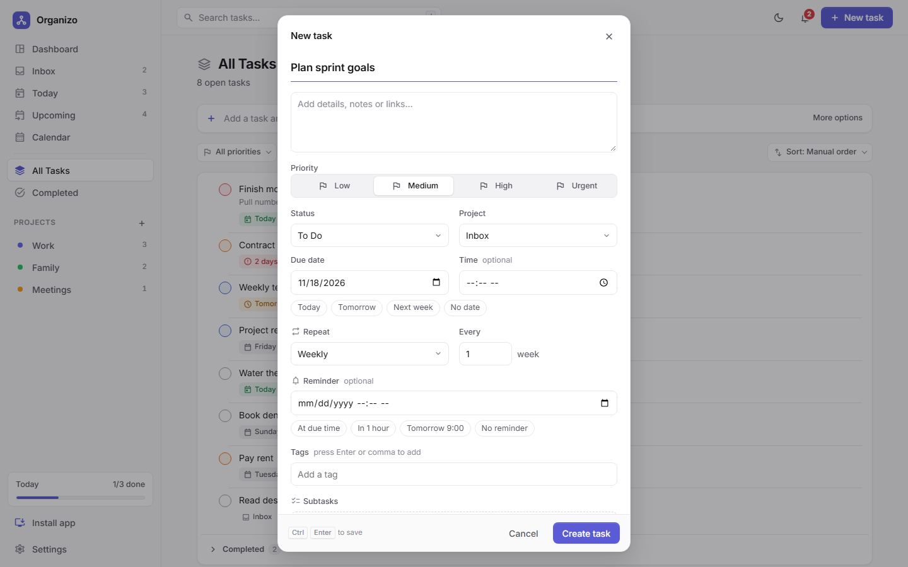
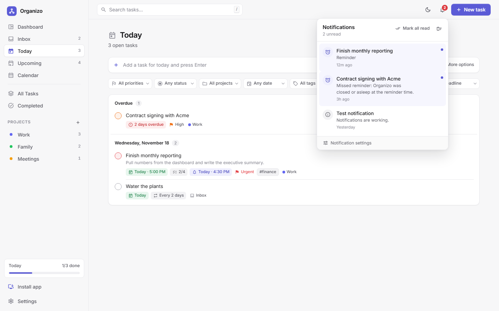
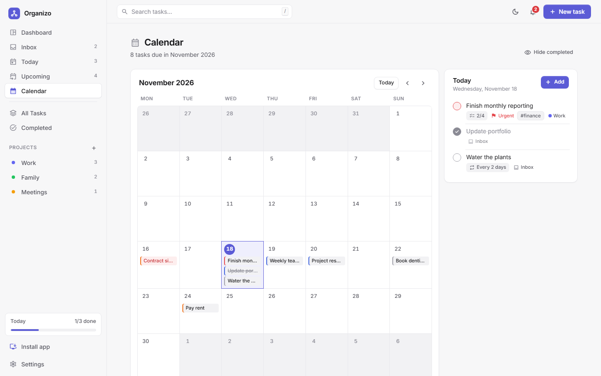
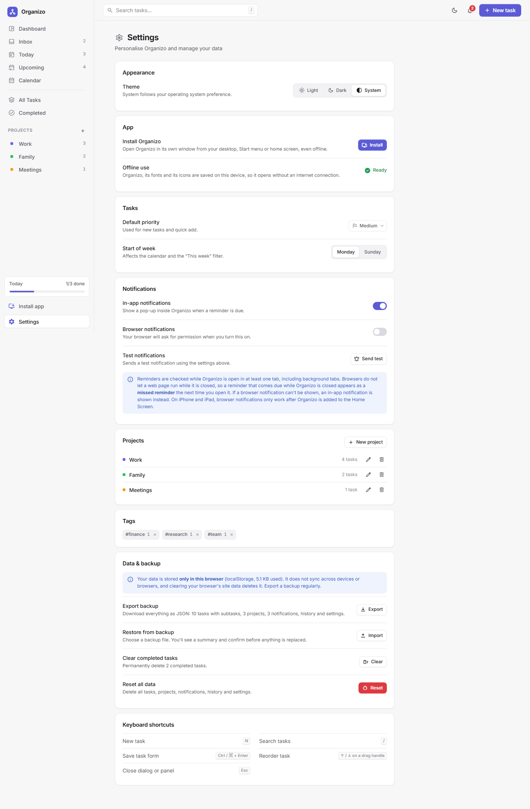
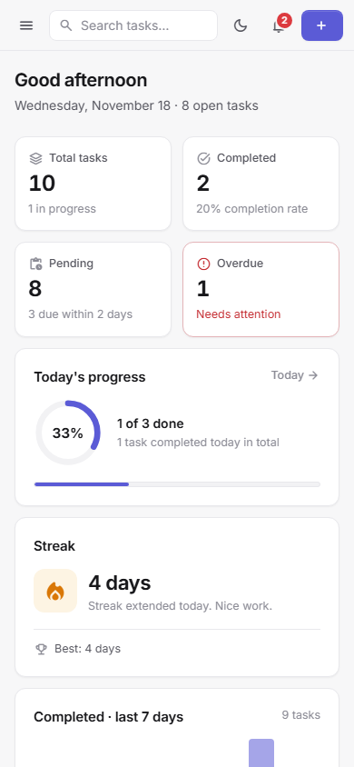
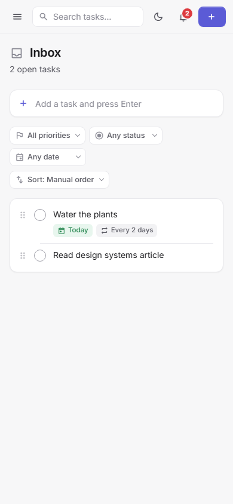
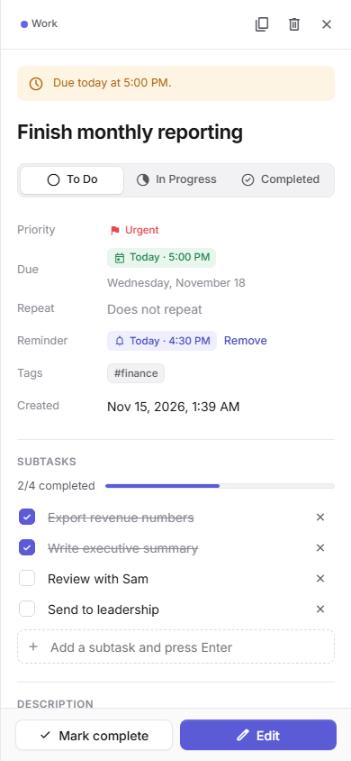

# Organizo

**Live demo: [organizoapp.netlify.app](https://organizoapp.netlify.app)**

A task manager that runs entirely in your browser, built with plain HTML, CSS and JavaScript modules. It has no framework, no build step and no npm dependencies. You can install it as an app, it works offline, and your data stays on your device.



- [Quick start](#quick-start)
- [Features](#features)
- [Screenshots](#screenshots)
- [Keyboard shortcuts](#keyboard-shortcuts)
- [Install and offline use](#install-and-offline-use)
- [Your data](#your-data)
- [Reminders and browser limitations](#reminders-and-browser-limitations)
- [Testing](#testing)
- [Project structure](#project-structure)
- [Known limitations](#known-limitations)

## Quick start

**Requirements:** [Node.js](https://nodejs.org/) 22 or newer. The browser tests also need Chrome, Edge or Chromium.

```bash
npm start
```

Then open **http://localhost:5173**. To use a different port, set the `PORT` environment variable.

The app uses ES modules, which browsers won't load from `file://`, so opening `index.html` directly won't work. Any static file server will do, for example `python -m http.server 5173`. To install the app and use it offline, it must be served from `localhost` or over HTTPS.

## Features

### Tasks
- Each task can have a title, description, priority (low, medium, high or urgent), status, a due date with an optional time, project, tags, a reminder, a repeat rule and subtasks.
- Create, edit, duplicate and delete tasks. Deleting asks for confirmation and can be undone.
- **Quick add:** type a title at the top of a list and press Enter. The task picks up that list's defaults and your default priority.
- Search, filter by priority, status, project, date or tag, and sort by manual order, deadline, priority, newest first or title.

### Views
- **Dashboard:** today's progress, completion streak, a chart of the last 7 days, upcoming deadlines and progress per project. Every number comes from your own tasks.
- **Lists:** Inbox, Today, Upcoming, All Tasks, Completed, and one list per project.
- **Calendar:** a month view of tasks by due date.

### Subtasks
- Add, check off, rename (click the title) and delete subtasks, either in the task form or directly in the task panel.
- Task rows show progress such as `2/4`, and the task panel shows a progress bar.

### Recurring tasks
- Tasks can repeat daily, weekly, monthly or yearly, or every *N* days, weeks, months or years.
- Completing a recurring task creates the next one. Subtasks carry over unchecked, and the reminder moves forward by the same number of days as the due date.
- Monthly and yearly tasks keep their day of the month: Jan 31 → Feb 28 → Mar 31, and Feb 29 → Feb 28 in non-leap years.
- If you complete a task late, the dates you missed are skipped, so the next due date is never in the past.
- **No duplicates:** the next task is created in the same save that completes the current one, and the two are linked. Reloading, completing again, or undoing and redoing never creates a second copy. Undo also removes the new task, as long as you haven't edited it.

### Reminders and notifications
- Set a reminder date and time on any task, or use a shortcut: at due time, in 1 hour, or tomorrow at 9:00.
- When a reminder is due, a pop-up appears in the app with **Open** and **Snooze 10 min**. The reminder is also saved to the **notification center**.
- The notification center, opened from the bell icon, shows a badge with the unread count. You can mark notifications read or unread, delete them, mark all as read, or clear them all.
- **Browser notifications** can be turned on in Settings, which asks the browser for permission. If permission is denied or the browser doesn't support them, the in-app pop-ups are used instead.
- Each reminder fires once, even across reloads. If several tabs are open, only one of them delivers reminders.

### Drag and drop
- Reorder tasks by dragging the grip handle with a mouse, finger or pen, or press ↑/↓ while the handle is focused. The new order is saved.
- Dragging works when a list is sorted by **Manual order**, which is the default for Inbox, All Tasks and projects. Other sorts and filters still work. Reordering a filtered list only moves tasks among the ones you can see; hidden tasks keep their place.

### Installable app
- Install Organizo from the **Install app** button (sidebar or Settings) or from the browser's install icon. It then opens in its own window from the desktop, Start menu or home screen.
- It **works offline** after the first visit, including its fonts and icons.
- App shortcuts (right-click the app icon, or long-press on Android): **New task**, **Today** and **Inbox**.

### Settings
- Theme (light, dark or follow the system), default priority, and whether the week starts on Monday or Sunday.
- App: install button and offline status.
- In-app and browser notification switches, with a button to send a test notification.
- Manage projects and tags.
- **Data & backup:** storage used, export, import with a preview, clear completed tasks, and reset all data.

## Screenshots

| | |
|---|---|
|  Task detail with subtasks, repeat rule and reminder |  Dark mode |
|  New task form |  Notification center |
|  Calendar |  Settings |

On mobile:

| | | |
|---|---|---|
|  |  |  |

All screenshots are in [docs/screenshots](docs/screenshots), including tablet and dark-mode views. To regenerate them, run `npm run screenshots`. It uses a demo workspace that exists only inside the test browser.

## Keyboard shortcuts

| Key | Action |
|---|---|
| `N` | New task |
| `/` | Search tasks |
| `Ctrl` / `⌘` + `Enter` | Save the task form |
| `↑` / `↓` on a drag handle | Move the task up or down |
| `Esc` | Close a dialog or panel |

## Install and offline use

Organizo is a Progressive Web App:

- **Installing.**
  - **Chrome and Edge** (desktop and Android): click **Install app** in the sidebar or Settings, or use the install icon in the address bar.
  - **Safari on iPhone and iPad:** tap **Share**, then **Add to Home Screen**.
  - **Firefox** on desktop doesn't support installing web apps, but offline use still works.
- **Offline.** A service worker ([sw.js](sw.js)) saves the app, its fonts and its icons on the first visit. After that, Organizo opens and works without an internet connection. *Settings → App* shows when it's ready.
- **Updates.** While online, the service worker always fetches the latest files first and only uses the saved copy when the network is unavailable. Changes appear on the next load, with no stale versions and no "please refresh" step.
- **Fonts and icons** are bundled in [assets/fonts](assets/fonts), so the app makes no requests to other sites. The icon font contains only the 106 icons the app uses (38 KB, instead of several MB for the full font).
- **Notifications** are shown through the service worker when possible. That's the only way some mobile browsers allow them; on iPhone and iPad they work only after adding Organizo to the Home Screen. Clicking a notification opens its task, even if Organizo was closed.

## Your data

There's **no backend and no account**. Everything is saved in your browser's `localStorage`:

- Your data stays on this device, in this browser profile.
- It does **not** sync between devices or browsers.
- Clearing the browser's site data deletes it, so export a backup regularly.
- Open tabs stay in sync with each other automatically.

**Backups.** *Settings → Data & backup → Export* downloads a JSON file containing everything: tasks and subtasks, projects, notifications, completion history and settings.

**Restoring.** *Import* checks the file before changing anything:
- It rejects invalid JSON, files from other apps and backups from newer versions of Organizo.
- It repairs or skips damaged records and tells you how many it skipped.
- It shows a summary of what's in the backup and asks you to confirm before replacing your data. You can undo the import straight afterwards.

**Reset all data** asks for confirmation and can also be undone straight afterwards.

**Versioning.** Saved data and backups record a schema version. When Organizo opens older data, [js/core/migrations.js](js/core/migrations.js) upgrades it one version at a time, and a copy of the original is kept in the browser. If the saved data is ever corrupted, Organizo backs it up instead of overwriting it and starts with an empty workspace.

## Reminders and browser limitations

A web page can only run while it's open. Organizo doesn't use a server or push service, so:

- Reminders are delivered **only while at least one Organizo tab is open**. Reminders still fire in background tabs, but browsers may delay them by up to about a minute.
- If a reminder falls due while Organizo is closed or the computer is asleep, it appears the next time you open the app, marked as a **missed reminder**.
- Some mobile browsers only allow notifications from installed apps. Installing Organizo enables them; otherwise it uses its in-app pop-ups. A service worker alone can't wake a closed app on a schedule; that would need a push server.

## Testing

```bash
npm test               # unit tests, then end-to-end tests
npm run test:unit      # logic only, with Node's built-in test runner
npm run test:e2e       # the real app in headless Chrome/Edge
npm run screenshots    # regenerate docs/screenshots
npm run icons:font     # rebuild the icon font subset after using a new icon (needs internet)
npm run icons:png      # re-render the PNG app icons from the SVG sources
```

- **Unit tests** ([tests/unit.test.mjs](tests/unit.test.mjs)) cover:
  - date handling and recurrence edge cases (month ends, leap years, late completion);
  - that the service worker caches every app file, the manifest's icons have the right sizes, nothing loads from other sites, and every icon used in the code is in the icon font;
  - input validation;
  - repairing damaged data and upgrading old data;
  - loading and saving.
- **End-to-end tests** ([tests/e2e.test.mjs](tests/e2e.test.mjs)) drive the real app through the Chrome DevTools Protocol, with real mouse, touch and keyboard input. They cover:
  - creating, editing and deleting tasks; subtasks; recurring tasks (including checks for duplicates);
  - reminders firing on time and missed reminders; granted and denied notification permission;
  - drag and drop, settings, and exporting and importing real backup files;
  - the installable app: service worker, manifest, self-hosted fonts and icons, the install flow, app shortcuts and notification clicks;
  - offline use, by stopping the server and reloading the app;
  - responsive layout and console errors.

The end-to-end tests start their own server on port 5199. They find Chrome, Edge or Chromium automatically; to use a different browser, set `CHROME_PATH` to its executable. One test waits for a reminder to fall due at the next full minute, so a full run takes 1–2 minutes.

## Project structure

```
index.html              App shell
manifest.webmanifest    Web app manifest (name, icons, shortcuts)
sw.js                   Service worker: offline cache and notification clicks
server.js               Static file server for local use
css/                    Styles: tokens (design system), base, layout, components, views
js/
  main.js               Startup: routing, rendering, theme, keyboard shortcuts
  store.js              App state and every action that changes it (validate, save, notify)
  storage.js            localStorage, backups, and migrations on load
  reminders.js          Reminder scheduling and notification delivery
  pwa.js                Service worker registration, install prompt, launch links
  router.js             Hash router (#/today, #/project/<id>, …)
  core/                 Pure logic: dates, data model and validation, recurrence, migrations, selectors
  ui/                   Components: dialogs, toasts, task row/form/detail, subtasks, drag and drop, notification center, sidebar
  views/                Dashboard, list views, calendar, settings
assets/fonts/           Self-hosted Inter and Material Symbols (with licences)
assets/icons/           App icons (SVG sources and generated PNGs)
scripts/                Icon font and app icon generators
tests/                  Unit tests, end-to-end tests, screenshot script, browser test helper
docs/screenshots/       Generated screenshots
```

How it fits together:

- **Rendering.** The interface is built with an `html` tagged template that escapes everything it inserts, so text you type can't inject HTML.
- **Events.** One delegated listener handles every `data-action` click, so buttons keep working after the page re-renders.
- **Saving.** Every change goes through `store.commit`. It saves to storage first and undoes the change if saving fails, so the screen never shows data that wasn't saved.

## Known limitations

- Reminders need an open tab or app window (see [above](#reminders-and-browser-limitations)).
- There's no sync between devices; use Export and Import to move your data.
- Drag and drop only reorders tasks within the current list. To move a task to another project or date, edit it.
- Weekly repeats are every *N* weeks from the due date; you can't pick particular weekdays.
- If the same recurring task is completed in two tabs at almost the same moment, you could get two copies of the next task.
- The first visit needs a connection (or a local server); offline use starts from the second load.
- Inter is bundled for Latin scripts only (including Albanian, German, French, Turkish and similar). Other scripts fall back to the system font.
